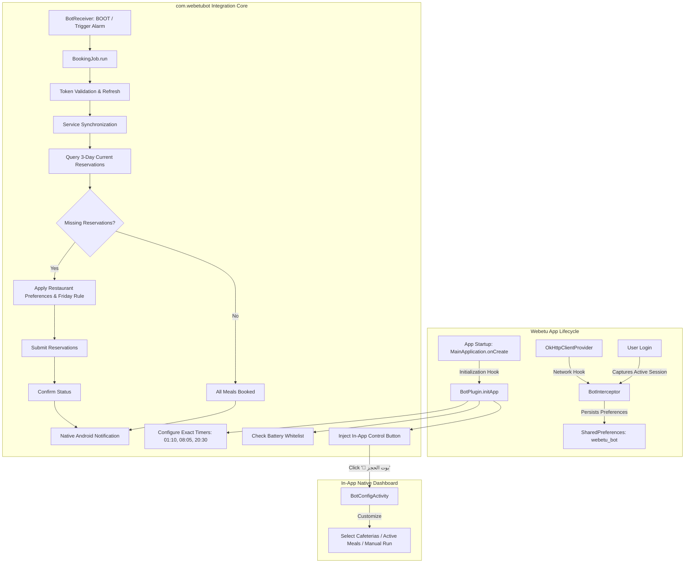
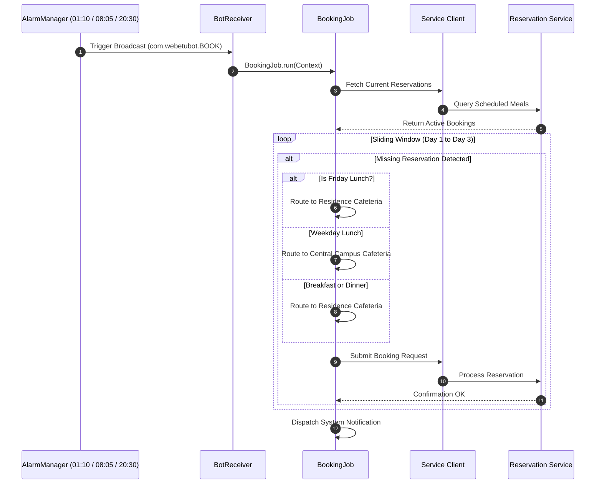

# 🤖 Webetu Bot — Autonomous University Canteen Reservation Assistant
### 🇩🇿 المساعد الذكي لحجز وجبات الإطعام الجامعي تلقائياً عبر تطبيق Webetu

[-green.svg)](#)
[](#)
[](#)
[](#)

---

### 📖 نبذة عن المشروع
> **مساعد ذكي ومدمج كلياً داخل تطبيق الطالب (Webetu)**، يقوم بحجز الوجبات اليومية (فطور الصباح، الغداء، العشاء) تلقائياً قبل 3 أيام من موعدها (الحد الأقصى المتاح)، مع اختيار المطاعم المناسبة (مطعم الإقامة أو المطعم المركزي) وتفادي نفاذ المقاعد أو نسيان الحجز.

#### 🌟 أهم ما يقدّمه البوت:
* ⚡ **مدمج داخل التطبيق الأصلي**: لا يحتاج لتثبيت أي تطبيق خارجي ولا يضيف أي إيقونة جديدة؛ يعمل بشكل طبيعي وسلس داخل نفس التطبيق.
* 🕒 **جدولة دقيقة وتلقائية**: يعمل في الخلفية 3 مرات يومياً (بعد منتصف الليل 01:10 لحجز اليوم الثالث الجديد فور فتحه، صباحاً 08:05، ومساءً 20:30 للتأكيد).
* 📱 **واجهة تحكم عربية مدمجة**: زر عائم `🤖 بوت الحجز` يظهر مباشرة في الصفحة الرئيسية يفتح شاشة تحكم عربية داكنة لاختيار المطاعم، تشغيل الحجز التجريبي، أو متابعة السجلات.
* 🔋 **حماية من إيقاف الخلفية (Doze Mode)**: متوافق مع قيود البطارية المتقدمة على أندرويد لضمان استمرار الحجز في الخلفية دون انقطاع.

---

An intelligent, fully autonomous meal reservation assistant integrated directly inside the **Webetu** student app (`app.progres.webetu` v2.5.0, Expo / React Native).

It automatically manages reservations for **Breakfast**, **Lunch**, and **Dinner** up to **3 days in advance** (the maximum server scheduling horizon) at designated residence and campus cafeterias, running completely in the background without requiring daily manual input.

---

## 📌 Table of Contents

- [Motivation & Overview](#-motivation--overview)
- [System Architecture](#-system-architecture)
- [Key Features & Capabilities](#-key-features--capabilities)
  - [1. Integrated In-App Module (`classes7.dex`)](#1-integrated-in-app-module-classes7dex)
  - [2. Automated Session & Credential Synchronization](#2-automated-session--credential-synchronization)
  - [3. Intelligent Meal Routing & Friday Handling](#3-intelligent-meal-routing--friday-handling)
  - [4. Exact Background Scheduling & Persistence](#4-exact-background-scheduling--persistence)
  - [5. Native Arabic RTL In-App Dashboard](#5-native-arabic-rtl-in-app-dashboard)
  - [6. Battery Optimization Management](#6-battery-optimization-management)
  - [7. Android 14+ 16KB Page Alignment](#7-android-14-16kb-page-alignment)
- [System Flowchart](#-system-flowchart)
- [Directory Structure](#-directory-structure)
- [Build & Installation Guide](#-build--installation-guide)
  - [Prerequisites](#prerequisites)
  - [One-Click Build](#one-click-build)
  - [Manual Step-by-Step Build](#manual-step-by-step-build)
  - [Installing via ADB](#installing-via-adb)
- [Configuration Reference (`webetu_bot.xml`)](#-configuration-reference-webetu_botxml)
- [Standalone Python Client](#-standalone-python-client)
- [License & Disclaimer](#-license--disclaimer)

---

## 💡 Motivation & Overview

For university students, meal reservations via the official Webetu student application are subject to tight daily schedules:
1. **Strict 3-Day Horizon**: Meal booking windows open strictly 3 days in advance.
2. **Quota Availability**: Cafeteria quotas often fill up early, making timely booking essential.
3. **Session Expiry**: Frequent session expirations require periodic manual re-authentication.
4. **OEM Background Restrictions**: Modern mobile operating systems put inactive apps to sleep, interrupting automated background tasks.

**The Solution**: An internal integration plugin (`com.webetubot` inside `classes7.dex`) embedded directly into the application lifecycle, handling exact alarm timing, automated session synchronization, and intelligent restaurant selection.

---

## ⚡ System Architecture



---

## 🛠️ Key Features & Capabilities

### 1. Integrated In-App Module (`classes7.dex`)
- **Seamless Single-App Experience**: Packaged cleanly inside `classes7.dex` under the namespace `com.webetubot`.
- **Zero Extra Launcher Icons**: Operates directly inside the Webetu application.
- **Application Lifecycle Integration**: Hooked into `MainApplication.onCreate()` to initialize background services on startup.

### 2. Automated Session & Credential Synchronization
- Implemented `BotInterceptor.smali` attached to `OkHttpClientProvider.smali` (`smali_classes4`).
- **Seamless Credential Sync**: Automatically preserves the active session when the student signs in normally.
- **Background Token Refresh**: Automatically detects expired sessions and refreshes authentication tokens without interrupting the user.
- **Account Isolation**: If a different student signs into the app, the plugin automatically resets previous cafeteria preferences to ensure meals are booked for the correct student.

### 3. Intelligent Meal Routing & Friday Handling
- Built-in decision engine in `BookingJob.smali`:
  - Evaluates active reservations over a 3-day sliding window.
  - Matches unbooked meals against configured preferences:
    - **Breakfast (Meal 1)** → Residence Cafeteria (e.g. مطعم الإقامة الجامعية).
    - **Lunch (Meal 2)** → Central Campus Cafeteria (e.g. المطعم الجامعي المركزي).
    - **Friday Lunch Exception**: Automatically switches Friday lunch reservations to the Residence Cafeteria since central campus facilities are closed on Fridays.
    - **Dinner (Meal 3)** → Residence Cafeteria.
  - **Data Sanitization**: Automatically trims unexpected trailing whitespace or tab characters in cafeteria identifiers.

### 4. Exact Background Scheduling & Persistence
- Built using `BotReceiver.smali` and `AlarmManager.setAndAllowWhileIdle()`:
  - Listens for `android.intent.action.BOOT_COMPLETED` so alarms persist across phone restarts.
  - Listens for custom execution broadcast `com.webetubot.BOOK`.
- **Three-Run Daily Schedule**:
  1. `01:10`: Runs immediately after midnight to capture the newly available 3rd day.
  2. `08:05`: Morning backup and verification run.
  3. `20:30`: Evening confirmation run.

### 5. Native Arabic RTL In-App Dashboard
- Injects a discrete control button `🤖 بوت الحجز` into the primary navigation view.
- **DecorView Watcher**: Checks the active window hierarchy to ensure the button displays cleanly on the main student dashboard.
- Includes `BotConfigActivity.smali`:
  - Native dark-mode layout with full Right-to-Left (RTL) Arabic support.
  - Master on/off toggle.
  - Independent meal selection (Breakfast, Lunch, Dinner).
  - 4 cafeteria selectors (Breakfast, Lunch, Dinner, Friday Lunch).
  - "احجز الآن" (Run Now) button for on-demand booking tests.
  - "تحديث المطاعم" (Refresh Cafeterias) sync button.
  - Real-time in-app activity log viewer.

### 6. Battery Optimization Management
- Protects background execution from aggressive OEM task termination.
- Manifest configuration with `REQUEST_IGNORE_BATTERY_OPTIMIZATIONS`.
- `BotBatteryPrompt.smali`:
  - Verifies battery optimization exemptions via `PowerManager.isIgnoringBatteryOptimizations`.
  - Prompts the user smoothly in the foreground with rate-limiting to prevent repeated notifications.

### 7. Android 14+ 16KB Page Alignment
- Fully compatible with modern Android platforms (including Android 14, 15, and 16 preview) using 16KB (`16384` bytes) page alignment during packaging.

---

## 📐 System Flowchart



---

## 📁 Directory Structure

```text
webetu-work/
├── .gitignore                   # Excludes APKs, JDK, build tools & logs from Git
├── .env.example                 # Environment configuration template
├── README.md                    # Project documentation
├── test_api.py                  # Standalone Python client script
├── build.ps1                    # One-click Windows PowerShell build script
├── build.sh                     # One-click Linux / macOS / Git-Bash build script
├── build.bat                    # One-click Windows Batch build script
├── apktool.jar                  # Packaging tool
├── bot.keystore                 # Signing keystore
│
├── src/                         # Application integration source tree
│   ├── AndroidManifest.xml      # Configured manifest with receivers and activities
│   ├── apktool.yml              # Build specifications
│   ├── smali_classes3/          # Integration hooks (MainApplication, MainActivity)
│   ├── smali_classes4/          # Network layer hooks (OkHttpClientProvider)
│   └── smali_classes7/          # Core Bot Package:
│       └── com/webetubot/
│           ├── BotPlugin.smali         # Entry point, alarm scheduling, UI watcher
│           ├── BotBatteryPrompt.smali  # Battery optimization dialog handler
│           ├── BotInterceptor.smali    # Session management & token refresh
│           ├── BookingJob.smali        # 3-day reservation engine & notifications
│           ├── BotReceiver.smali       # Alarm and boot broadcast receiver
│           ├── BotConfigActivity.smali # Native RTL Arabic settings dashboard
│           └── GsApi.smali             # Communication and payload handler
│
└── bt/android-14/               # Android Build Tools (zipalign, aapt2, apksigner)
```

---

## 🚀 Build & Installation Guide

### Prerequisites
- **Java JDK 17+** (In your PATH or placed in `jdk-17.0.21+9`).
- **Android SDK Build Tools** (`zipalign` and `apksigner`).
- **ADB** (Android Debug Bridge) for device installation.

### One-Click Build

#### On Windows (PowerShell):
```powershell
.\build.ps1
```

#### On Windows (Command Prompt):
```cmd
build.bat
```

#### On Linux / macOS / Git-Bash:
```bash
chmod +x build.sh
./build.sh
```

### Manual Step-by-Step Build

```bash
# 1. Recompile source directory
java -jar apktool.jar b src -o rebuilt.apk

# 2. 16KB Page Alignment (Required for modern Android versions)
bt/android-14/zipalign -p -f 16384 rebuilt.apk rebuilt_aligned.apk

# 3. Sign the APK
java -jar bt/android-14/lib/apksigner.jar sign \
  --ks bot.keystore \
  --ks-key-alias botkey \
  --ks-pass pass:webetu123 \
  --key-pass pass:webetu123 \
  --out webetu-bot-release.apk \
  rebuilt_aligned.apk
```

### Installing via ADB

```bash
# Install preserving existing data
adb install -r webetu-bot-release.apk

# Launch the application
adb shell am force-stop app.progres.webetu
adb shell monkey -p app.progres.webetu -c android.intent.category.LAUNCHER 1
```

### Triggering an Immediate Booking Run
```bash
adb shell am broadcast -a com.webetubot.BOOK -n app.progres.webetu/com.webetubot.BotReceiver
```

---

## ⚙️ Configuration Reference (`webetu_bot.xml`)

Preferences are stored in Android `SharedPreferences` at:
`/data/data/app.progres.webetu/shared_prefs/webetu_bot.xml`

| Key | Type | Default | Description |
| :--- | :--- | :--- | :--- |
| `enabled` | int | `1` | Master bot toggle (`1` = active, `0` = disabled) |
| `meals` | string | `1,2,3` | Active meal IDs (`1` = Breakfast, `2` = Lunch, `3` = Dinner) |
| `depot_meal1` | string | `101` | Cafeteria ID for Breakfast (Residence) |
| `depot_meal2` | string | `202` | Cafeteria ID for Lunch (Central Campus) |
| `depot_meal3` | string | `101` | Cafeteria ID for Dinner (Residence) |
| `depot_lunch_friday` | string | `101` | Cafeteria ID for Friday Lunch (Residence override) |
| `battery_prompt_after` | long | epoch ms | Rate-limit timestamp for battery optimization prompt |
| `username` | string | (synced) | Active student username |
| `password` | string | (synced) | Active student password |
| `token` | string | (synced) | Active session authentication token |

---

## 🐍 Standalone Python Client

A standalone script is available in `test_api.py` for testing connectivity and reviewing upcoming reservations directly from your terminal:

```bash
# Set up your environment
cp .env.example .env
# Edit .env with your credentials

# Run script
python test_api.py
```

---

## ⚖️ License & Disclaimer

This project is developed for educational and research purposes to demonstrate automated background task orchestration and mobile application integration. All product names, logos, and brands are property of their respective owners.
